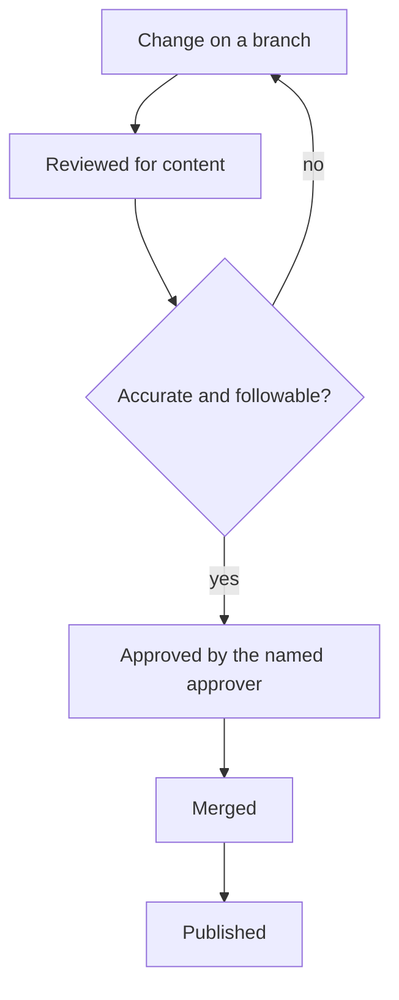

## The path

[d360]: # 'mermaid caption="Review and approval are separate steps, often different people."'

[d360]: # "/mermaid"

## What each step asserts

[d360]: # 'table border="all" striped="true"'

| Step | Asserts |
| :--- | :--- |
| Review | Somebody competent read this and believes it is right |
| Approval | A named person accepts responsibility for it being in force |
| Merge | This is now the current text |
| Publish | Readers can see it |

[d360]: # "/table"

> [!IMPORTANT]
> **Review and approval are different jobs**
>
> A reviewer checks the content. An approver takes responsibility for it. In a small team the same
> person often does both — which is fine, as long as everybody knows that is what happened.

## Making the approver real

[d360]: # 'multi-level-list styles="decimal,lower-alpha"'

1. **Name them**, in the control block, as a person.
2. **Enforce it in the repository**, so the merge cannot happen without them.
   1. Convention alone fails under deadline.
   2. The first time it is bypassed, the history stops being evidence.
3. **Record what they approved**, which the commit does for you.

[d360]: # "/multi-level-list"

> [!CAUTION]
> **An approval nobody read is worse than no approval**
>
> It puts a name against text that was never checked, and tells everybody downstream the procedure
> was verified. The record becomes evidence for a claim that was never true.

[d360]: # "faq"

Can the author approve their own procedure?

The repository can be configured to forbid it, and on controlled documents it usually should be. The
point of approval is a second person accepting responsibility; self-approval provides the record
without the substance.

What about an urgent correction?

Run it through the same path, faster. An emergency route that skips approval will be used for things
that are not emergencies, and it is impossible to tell afterwards which was which.

How do we show an auditor who approved what?

The commit history: the change, the author, the approver, the timestamp. It is worth rehearsing the
answer before somebody asks, including what you would show on a screen.

[d360]: # "/faq"

[d360]: # 'callout kind="success"'

> **The evidence is a side effect of working normally**
>
> Nobody keeps a separate approval register, and nothing has to be remembered at the end of the
> quarter. That is the real argument for running controlled documents this way.

[d360]: # "/callout"

[d360]: # 'snippet name="deleteMe"'
