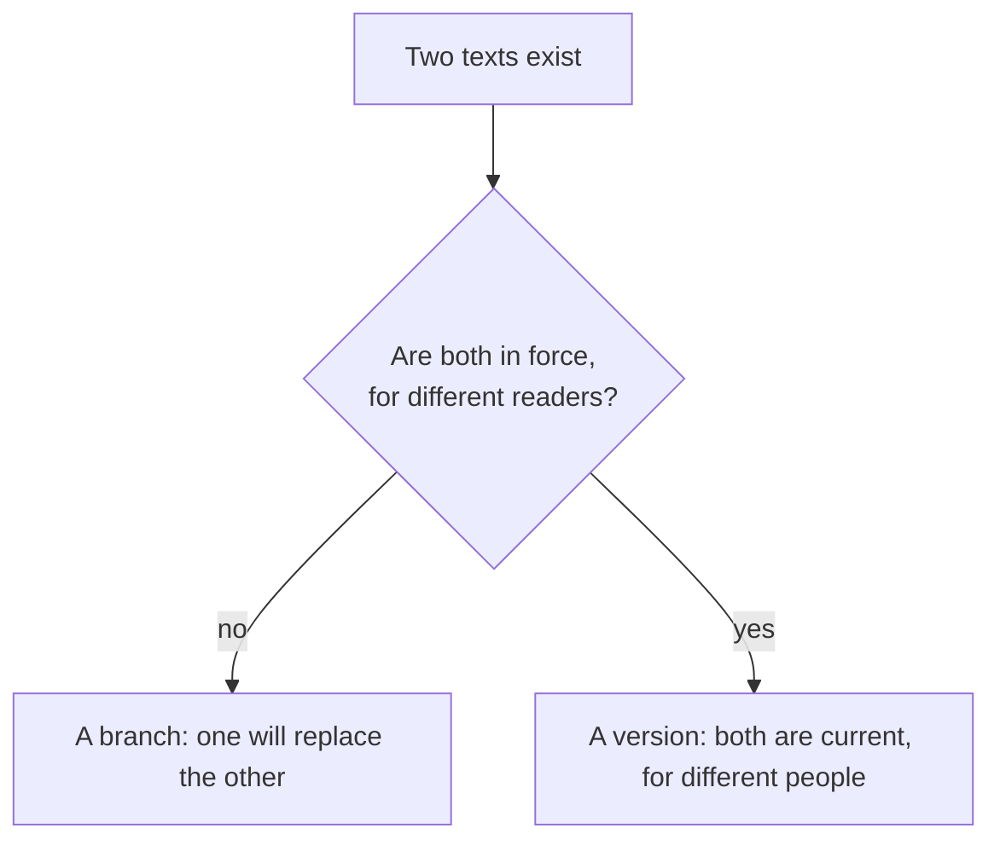

[d360]: # 'snippet name="verifyNote"'

Sometimes two texts have to be in force at once — two sites on different equipment, or a regulation
changing on a known date. In this product type the mechanism for that is a **long-lived branch** per
text in force. Whether a project of this type can also hold parallel versions behind a reader-facing
picker is worth confirming before you plan around it; the branch route is the one you can rely on.

## When you need one

[d360]: # 'table border="all" striped="true"'

| Situation | Version? |
| :--- | :--- |
| Two sites running different equipment, both supported | Yes |
| A regulation changing on a known date | Yes, until the old one lapses |
| A procedure improved, applying to everybody | No — change it |
| A typo | No |

[d360]: # "/table"

> [!IMPORTANT]
> **A version is a copy, and copies diverge**
>
> Every correction afterwards is a decision made twice. Three live versions means every fix is a
> three-way decision forever, including the ones nobody remembers to make.

## Branch or version

[d360]: # 'mermaid caption="A branch is work in progress; a version is two things in force at once."'

[d360]: # "/mermaid"

> [!NOTE]
> **The distinction is not technical, it is about who is relying on the text**
>
> A branch is a proposal. A version is a published procedure somebody is following today. Treating a
> version as a long-lived branch is how an unapproved draft ends up in force.

## Keeping the cost down

- [ ] Retire old versions on a stated schedule, and say so on them.
- [ ] Decide which versions get a fix when you make it, not later.
- [ ] Make it obvious on the page which release it describes.

> [!CAUTION]
> **A reader on the wrong version will not notice**
>
> They arrived from a search result or a bookmark and have no reason to check a selector. If the
> versions differ in ways that matter, the page itself has to say which one it is.

> [!TIP]
> **Set the retirement date when you create the version**
>
> Versions are easy to create and politically hard to delete. An end date agreed at the start turns a
> deletion into a scheduled event rather than an argument.

[d360]: # 'snippet name="deleteMe"'
