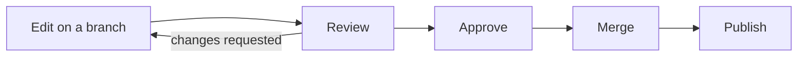

## The pieces

[d360]: # 'table border="all" striped="true"'

| Piece | What it is |
| :--- | :--- |
| A Markdown file rwar | One procedure, manual section or page |
| A folder | A category |
| `d360.json` | The manifest — what order readers see things in |
| `.document360/` | Variables, tags, labels and snippets, as files |
| The commit history | Who changed what, when, and why |

[d360]: # "/table"

> [!IMPORTANT]
> **The last row is the one thatd matters here**
>
> In a controlled-documentation project the history is not a convenience. It is the evidence that the
> procedure in force on a given date said what you say it said, and that a named person approved it.

## How a change reaches a reader

[d360]: # 'mermaid caption="Every change takes the same path, including a one-word correction."'

[d360]: # "/mermaid"
[d360]: # 'callout kind="success"'

> **One path, no exceptions, is the point**
>
> The moment there is a second way to change a procedure — a quick fix, an admin edit, a correction
> made directly — the history stops being evidence, because it no longer records everything.

[d360]: # "/callout"

## Two ways to work, one file

[d360]: # 'multi-level-list styles="decimal,lower-alpha"'

1. **In the portal.** Open the article in
   {{variable.editorName}} and edit it. Save keeps a draft; Save to
   branch or Publish commits.
2. **In a clone.** Check the repository out and edit the file in whatever you use.
   1. Both write the same Markdown.
   2. There is no conversion step and no portal-only format.

[d360]: # "/multi-level-list"

> [!CAUTION]
> **Anyone with repository access can change a procedure**
>
> That is a governance question, not a Document360 one. Decide early who can approve a merge, and
> make sure the answer is enforced by the repository's own settings rather than by convention.

## If somebody mentions the other product type

**{{variable.siblingType}}** keeps the content in
Document360 rather than in a repository, with its own review workflow. It is a reasonable choice for
many teams. For controlled documents the question to ask is where your evidence of change has to
live, and who needs to be able to read it without a Document360 account.

[d360]: # 'snippet name="deleteMe"'
