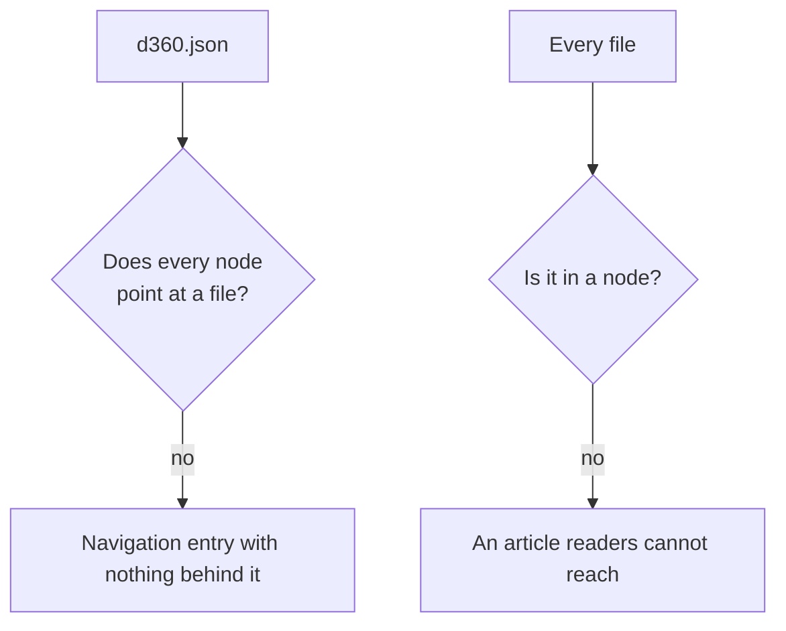

A folder is a category. `d360.json` is the navigation. They are separate on purpose.

## What the manifest looks like

```json lineNumbers
{
  "serializerVersion": 1,
  "languages": [{ "code": "en", "default": true }],
  "nodes": [
    {
      "paths": [{ "langs": ["en"], "path": "start-here/README.md" }],
      "children": [
        { "paths": [{ "langs": ["en"], "path": "start-here/your-first-change.md" }] }
      ]
    }
  ]
}
```

Order in the file is order in the tree. Moving a procedure up the navigation edits the manifest and
leaves the file where it is.

> [!IMPORTANT]
> **Reordering is a manifest change, not a file move**
>
> This is the thing that surprises people arriving from a folder-based system. It is also what makes
> reorganising a large manual cheap: one reviewable diff, no renamed files, no broken addresses.

## The two failures to check for

[d360]: # 'mermaid caption="Both are silent; both are trivially detectable."'



[d360]: # "/mermaid"

> [!CAUTION]
> **A procedure in no node is a procedure nobody can find**
>
> It is published, it is correct, and it is invisible. On a controlled manual that is worse than a
> missing page, because everybody believes it is available.

## A category's own page

A folder's `README.md` is its page. It can be a real page readers land on, or it can send them
straight to the first procedure — which suits a category whose landing page would say nothing.

> [!TIP]
> **Write the landing page or skip it; do not leave it empty**
>
> A category page listing its own children is a page readers click through without reading. Either
> say something useful about the group or send them past it.

[d360]: # 'snippet name="deleteMe"'
