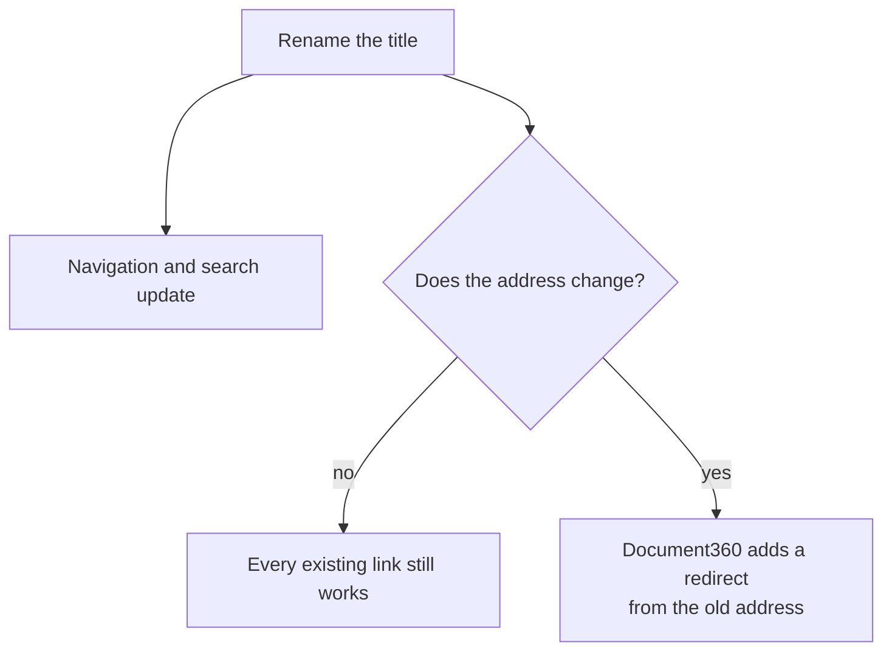

A procedure's address outlives its title. On controlled documents it may also be printed on a
laminated card on a wall, which changes the stakes considerably.

## What a rename affects

[d360]: # 'mermaid caption="A title change and an address change are different decisions."'

[d360]: # "/mermaid"

> [!IMPORTANT]
> **Keep the address when you change the title**
>
> A title is editorial and will be improved several times. An address is a promise to everybody who
> saved, printed or linked to the page.

## Where links to a procedure live

[d360]: # 'table border="all" striped="true"'

| Place | Can you fix it? |
| :--- | :--- |
| Other pages in this project | Yes, and you should |
| An intranet page | Usually, eventually |
| A training deck from two years ago | No |
| A printed card on a wall | No |
| Somebody's bookmark | No |

[d360]: # "/table"

> [!CAUTION]
> **The rows you cannot fix are why addresses are worth protecting**
>
> In a software documentation project a broken link is an annoyance. On a procedure somebody is
> trying to follow right now, it is a person standing in front of a machine with a dead link.

## If an address must change

Renaming the file in Git changes the slug, and Document360 creates the redirect from the old address
for you. Those redirect rules live in Document360 at project level, not in the repository, so they
take effect immediately and are not part of a pull request.

The redirect is not the whole job:

- [ ] Fix the links inside this project — one search.
- [ ] Tell whoever maintains the places you cannot reach.
- [ ] Record it, so the next person knows the page moved.
- [ ] Check the old address resolves once the change is published.

[d360]: # 'callout kind="success"'

> **Document numbers survive renames for exactly this reason**
>
> If your procedures carry stable identifiers, use them in the address and spend your titles freely.
> It is the one piece of traditional document control that repays keeping.

[d360]: # "/callout"

[d360]: # 'snippet name="deleteMe"'
